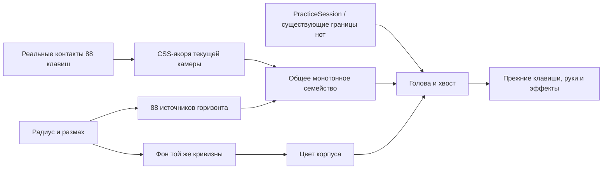

# Художественная проекция нот

Режим добавлен по `PIANO_NOTE_PROJECTION_SPEC.md`. Он меняет проекцию нот, а не модель, освещение,
руки, физические клавиши, MIDI-команды или время песни.

## Включение

В настройках «Вид → Падающие ноты → Система проекции» выберите «Художественная проекция». Она
работает с существующей клавиатурой «3D» в обычном виде и при свободной камере. «Прежняя проекция»
остаётся начальным значением. Классика, аркада, режим печати и сценическая камера продолжают
использовать прежний рендер. При неподходящем ракурсе включается безопасный возврат с диагностикой;
параметры клавиатуры автоматически не переставляются.

Внешний экранный горизонт независим от прежних метров свободного мира. При движении камеры
обновляются только действительные контакты клавиш; экранный радиус не меняет FOV. Все 88 дорожек
существуют даже при диапазоне камеры «По песне». Невидимые края обрезаются, а не перенумеровываются:
`pitch − 21` всегда даёт индекс 0–87.

## Настройки версии 1

| Поле                         | Начальное значение | Смысл                                                                  |
| ---------------------------- | ------------------ | ---------------------------------------------------------------------- |
| mode                         | legacy             | Переключатель рендера                                                  |
| horizonY                     | 0.17               | Средняя высота в долях высоты игрового canvas                          |
| horizonSpread                | 0.92               | Размах в долях ширины canvas                                           |
| horizonRadius                | 2.0                | Радиус в долях ширины canvas; числовой ввод и логарифмический ползунок |
| horizonArcDirection          | up                 | Середина выше краёв; down меняет направление                           |
| depthExponent                | 1.6                | Нелинейный закон приближения                                           |
| landingStraighten            | 0.16               | Доля доступной высоты для вертикального окончания                      |
| noteScaleNear / noteScaleFar | 1.0 / 0.12         | Масштаб на ближнем и дальнем конце                                     |
| laneGlow / noteGlow          | 1 / 1              | Независимая интенсивность линий и нот                                  |
| debugMapping                 | false              | Точки, индексы, pitch, C4 и диагностика                                |
| debugEvery12                 | false              | Упрощённый показ направляющих и подписей                               |
| geometryOnly                 | false              | Фон и декоративное свечение выключены                                  |

Пресеты: **Прямой горизонт** (R=10000 ширин), **Изогнутый горизонт** (R=0.75), **Кинематографический
закат** (R=1.4, noteGlow=1.4). Настройки сохраняются существующим механизмом предпочтений. Числовые
поля допускают дробный ввод; изменение радиуса не сбрасывает положение камеры и песню.

## Формулы и слои

Единицы математики — CSS px. DPR применяется существующим рендерером один раз.

```text
index = pitch − 21
xH = W × ((1 − spread)/2 + spread × (index + 0.5)/88)
R = max(radius × W, halfSpan + 1, safeRadiusForLanding)
sag = dx² / (R + sqrt(max(0, R² − dx²)))
yH = horizonY × H ± sag
y(u) = yH + (yK − yH) × u^depthExponent
x(y) = (1 − smoothstep(joinY, straightenY, y)) × xH
     + smoothstep(joinY, straightenY, y) × xK
```

Все дорожки используют одни и те же горизонтальные сечения. Их порядок сохраняется при любых
различающихся Y чёрных/белых контактов, если исходный порядок X корректен. Последний участок
вертикален и C1-гладок. Радиус безопасно увеличивается при нехватке места; `horizonTooCurved`
показывает ограничение и эффективный радиус. Источники и процедурный закат используют одну
окружность, а не независимую декоративную полосу.



`ProjectionKeyAnchors` читает существующие матрицы hinge и `nativeKeyContactPoint`, включая
асимметрию белых стержней. `projectionNoteProgress` читает готовый `ThreeRoadFrame`; новых часов
нет. `ProjectionNoteBatch` рисует ограниченный переиспользуемый буфер, а пальцы и названия пекутся в
общий атлас. Фон рисуется до корпуса, ноты — перед клавишами/руками. Старые подписи временно
скрываются только при действительном новом режиме и возвращаются синхронно при отключении native
host, fallback или уничтожении слоя.

## Проверки

Полный вывод геометрии и таблица находятся в
[NOTE_PROJECTION_GEOMETRY.md](../NOTE_PROJECTION_GEOMETRY.md). Проверены
1920×1080,1366×768,375×667,390×844 × три пресета: **88 дорожек, 0 пересечений**. Та же таблица
пройдена с действительными матрицами камеры и контактами физического диапазона. Реальные пересечения
проверяются попарно по полилиниям; положение при одинаковом u само по себе не считается
доказательством. Тесты также проверяют длительную ноту, отпускание, паузу, seek, отсечение,
независимость настроек, альфа/цвет и возврат legacy.

```text
pnpm exec vitest run src/render/stylizedProjection.test.ts src/render/three/projectionKeyAnchors.test.ts src/render/three/projectionNoteProgress.test.ts src/render/three/ProjectionNoteBatch.test.ts src/render/three/StylizedProjectionLayer.test.ts
pnpm check
pnpm spec:validate
```

Диагностика `offscreenAnchors` считает и источники, и контакты; это допустимое отсечение.
`nonMonotonicKeyOrder` и контакты за камерой требуют fallback, а не сортировки MIDI-номеров. Режим
«каждая 12-я» не удаляет музыкальные ноты. Чистая геометрия не меняет сохранённые настройки эффектов
прежнего режима.

## Ограничения

Это экранная художественная проекция, не физическая сфера. Опциональные arcLength/виртуальная сфера
из ТЗ не реализуются до отдельной приёмки. Задник процедурный: градиент заката и облачная дымка без
скачанных изображений. Все 88 клавиш дают узкие дорожки на маленьком экране; подсказки не заменяют
масштабирование физической клавиатуры. При обратном/боковом ракурсе свободной камеры геометрический
порядок может нарушиться — тогда остаётся прежний мир с понятным сообщением. Тесты программного
ввода не являются аппаратной MIDI-приёмкой.

## Приёмка 25.10.2026

| Проверка                                   | Результат                                                               |
| ------------------------------------------ | ----------------------------------------------------------------------- |
| Дорожки / источники / контакты             | 88 / 88 / 88, MIDI 21–108                                               |
| Пересечения                                | 0 для 3 пресетов×4 размеров, включая настоящие матрицы камеры           |
| Контакты                                   | Сравнение с независимой worldCamera.project с точностью 6 знаков CSS px |
| Desktop / mobile                           | 1920×1080,320×568,390×844,667×375; DPR 1/2, без overflow                |
| Свободная камера                           | Корпус, ножки и 3D-руки видны; legacy возвращается                      |
| Debug/free/resize/legacy после исправления | 526997 проверенных WebGL-команд, 0 ошибок                               |

Сопоставимый замер foreground Chrome на одном ПК,1920×1080,DPR 1,тот же урок и интервал 08→10 с, 75%
прослушивания. Это измерение dev-стенда, не гарантия производительности всех устройств:

| Режим    | FPS    | p95 кадра | Draw calls / кадр |
| -------- | ------ | --------- | ----------------- |
| Legacy   | 109.63 | 12.2 мс   | 423.81            |
| Stylized | 114.76 | 12.2 мс   | 418.88            |

Во время приёмки найден и исправлен WebGL 1281: диагностический CanvasTexture увеличивал размер
поверх прежнего immutable storage. Теперь перед resize освобождается GPU-текстура; затем проверены
freeON/OFF×3, legacy, resize в том же GL-контексте и mobileDPR 2→desktopDPR 1. Добавлен отдельный
регрессионный тест размеров 806→1008→806.

Локальный полный `pnpm check` прошёл с `VITEST_MAX_WORKERS=2`:3673 теста и 23 теста компилятора,
линтер, TypeScript, сборка. Первый параллельный прогон превысил таймаут неизменённого
handSolver/chunks; лимиты и код рук не менялись. Дополнительный тест исправления текстуры прошёл
отдельно; окончательный CI PR выполняет весь набор заново. `pnpm spec:validate` —72/72.

Скриншоты сохранены локально в игнорируемой `.browser-artifacts`: `stylized-final-flat.png`,
`stylized-final-curved.png`, `stylized-final-sunset.png`, `stylized-final-debug88.png`,
`stylized-final-mobile320-settings.png`, `stylized-final-mobile390-settings.png`,
`stylized-final-mobile667-settings.png`, `stylized-final-geometry-confirmed.png`,
`stylized-final-free-hands-case.png`. Генеративные изображения для доказательства реализации не
использовались.
